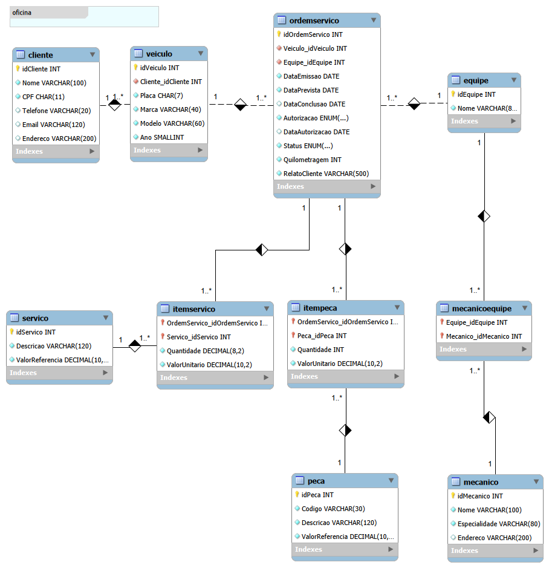

# Oficina Mecânica — Modelagem de Banco de Dados com MySQL


Banco de dados relacional para acompanhar atendimentos de uma oficina mecânica, com cadastro de clientes e veículos, equipes de mecânicos, ordens de serviço, peças e mão de obra.

O projeto demonstra modelagem relacional, aplicação de regras de integridade e consultas SQL para analisar valores de ordens, recorrência de atendimentos, carga das equipes e cumprimento de prazos.

## 🛠️ Tecnologias

- **MySQL 8:** criação de tabelas, constraints, view e consultas.
- **MySQL Workbench:** execução dos scripts e geração do diagrama EER.
- **SQL:** DDL, inserção de dados, filtros, junções, agrupamentos e atributos derivados.

## 📐 Diagrama EER



O diagrama foi gerado no MySQL Workbench a partir do esquema da oficina. O script SQL contém a definição completa dos campos, tipos e constraints.

## 🗂️ Estrutura do modelo

| Tabela | Finalidade |
| --- | --- |
| `Cliente` | Identificação e contato dos clientes. |
| `Veiculo` | Cadastro dos veículos e vínculo com o proprietário. |
| `Equipe` | Equipes responsáveis pelos atendimentos. |
| `Mecanico` | Profissionais e especialidades. |
| `MecanicoEquipe` | Associação entre mecânicos e equipes. |
| `OrdemServico` | Veículo, equipe, relato, quilometragem, datas, autorização e status. |
| `Servico` | Catálogo de serviços e valores de referência. |
| `ItemServico` | Serviços incluídos em cada ordem, quantidades e valores unitários. |
| `Peca` | Catálogo de peças e valores de referência. |
| `ItemPeca` | Peças incluídas em cada ordem, quantidades e valores unitários. |

A view **`vw_TotalOrdemServico`** calcula o subtotal de serviços, o subtotal de peças e o valor total de cada ordem.

## 🔐 Regras de negócio

- Um cliente pode possuir vários veículos; cada veículo pertence a um cliente.
- Cada ordem de serviço está vinculada a um veículo e a uma equipe responsável.
- Um mecânico pode participar de várias equipes, e uma equipe pode reunir vários mecânicos.
- Uma ordem pode conter vários serviços e peças. As tabelas associativas usam chaves primárias compostas.
- CPF, placa, nome de equipe e código de peça possuem restrições de unicidade.
- Quantidades devem ser positivas. Valores monetários e quilometragem não podem ser negativos.
- A data prevista não pode anteceder a emissão da ordem.
- Ordens em execução ou concluídas exigem autorização do cliente e data de autorização.
- Uma autorização recusada exige que a ordem esteja cancelada.
- Ordens concluídas exigem data de conclusão igual ou posterior à emissão e à autorização.
- O preço unitário é registrado nos itens da ordem, preservando o valor praticado quando o catálogo muda.

### Valores das ordens

```text
Subtotal do item = Quantidade × ValorUnitario
Total da ordem = Total dos serviços + Total das peças
```

Os serviços e as peças são agregados separadamente antes das junções, evitando duplicar valores em ordens com vários itens. Ordens sem itens também aparecem na view, com total zero.

## 🔎 Consultas e perguntas de negócio

O arquivo `sql/03_consultas.sql` contém **18 consultas comentadas**. Elas exploram:

- Serviços disponíveis e ordens em execução.
- Veículos por cliente e quantidade de ordens, incluindo clientes sem atendimentos.
- Clientes com mais de uma ordem.
- Subtotais de serviços e composição do total de cada ordem.
- Clientes com mais de R$ 600 em ordens concluídas.
- Ordens em atraso e tempo de atendimento.
- Serviços mais frequentes e valores de peças em ordens concluídas.
- Carga das equipes e composição por mecânicos.
- Orçamentos aguardando autorização.
- Diferenças entre preços praticados e valores atuais do catálogo.
- Valor e ticket médio das ordens concluídas por equipe.
- Veículos sem ordens de serviço.

As consultas utilizam `SELECT`, `WHERE`, expressões calculadas, `ORDER BY`, `GROUP BY`, `HAVING`, `INNER JOIN`, `LEFT JOIN`, `CASE` e `NOT EXISTS`.

## 🧩 Dados de demonstração

Todos os dados são fictícios. A carga inclui **5 clientes, 6 veículos, 3 equipes, 4 mecânicos, 6 serviços, 5 peças e 8 ordens**, além dos itens e associações.

Os cenários contemplam ordens concluídas, em execução, canceladas e aguardando autorização; atendimento atrasado; cliente sem ordens; vários itens em uma mesma ordem e preço praticado diferente da referência atual.

A criação do esquema e da view foi executada no MySQL local. Durante o desenvolvimento, foram observadas rejeições de alterações inválidas relacionadas a quantidade zero, execução sem autorização e veículo inexistente. Os cálculos e as 18 consultas também passaram por uma validação complementar em SQLite com adaptações explícitas; isso não equivale à validação integral das consultas no MySQL.

## 🚀 Como executar

**Pré-requisitos:** MySQL 8.0.16 ou superior, para aplicação das constraints `CHECK`, e um cliente SQL, como o MySQL Workbench.

1. Conecte-se ao servidor MySQL.
2. Abra e execute `sql/01_criacao_oficina.sql` para criar o esquema, as 10 tabelas e a view.
3. Execute `sql/02_insercao_dados.sql` uma única vez, com as tabelas vazias.
4. Execute as consultas de `sql/03_consultas.sql`, individualmente ou pelo script completo.

No Workbench, abra os arquivos em **File → Open SQL Script**. Os scripts selecionam o esquema com `USE oficina`.

A criação não limpa um banco existente. A inserção usa identificadores fixos e sua repetição sobre os mesmos dados pode causar conflitos de chave.

A consulta de atraso usa a data fixa `2026-10-22`, definida em `@data_referencia`, para manter os resultados reproduzíveis. Altere a variável para analisar outra data.

## 📁 Arquivos

| Caminho | Conteúdo |
| --- | --- |
| `sql/01_criacao_oficina.sql` | Criação do banco, tabelas, constraints e view. |
| `sql/02_insercao_dados.sql` | Inserção dos dados fictícios. |
| `sql/03_consultas.sql` | 18 consultas com perguntas de negócio. |
| `imagens/oficina.png` | Diagrama exportado do MySQL Workbench. |

## 📝 Decisões e limites do cenário

O modelo considera clientes pessoa física, um proprietário atual por veículo e uma equipe responsável por ordem. O cliente da ordem é obtido pelo veículo; alterações de propriedade exigiriam uma evolução para preservar esse histórico.

A composição das equipes não é versionada e não identifica quem executou individualmente cada serviço. Os itens representam peças e serviços orçados, sem controle de estoque ou consumo físico. O modelo não inclui pagamentos; o valor de ordens concluídas não representa necessariamente dinheiro recebido.

CPF é verificado por tamanho e unicidade, sem validação de dígitos verificadores. As constraints validam o estado atual das ordens; a aplicação deve controlar a sequência de transições e a edição de ordens encerradas.

## 📚 Referências e créditos

Projeto elaborado a partir do cenário de oficina mecânica da atividade **Construa um Projeto Lógico de Banco de Dados do Zero**, da **DIO**. A modelagem foi desenvolvida para este projeto.

O **ChatGPT** foi utilizado como apoio na elaboração e revisão da modelagem, dos scripts e da documentação. O diagrama publicado foi gerado e organizado no MySQL Workbench.
